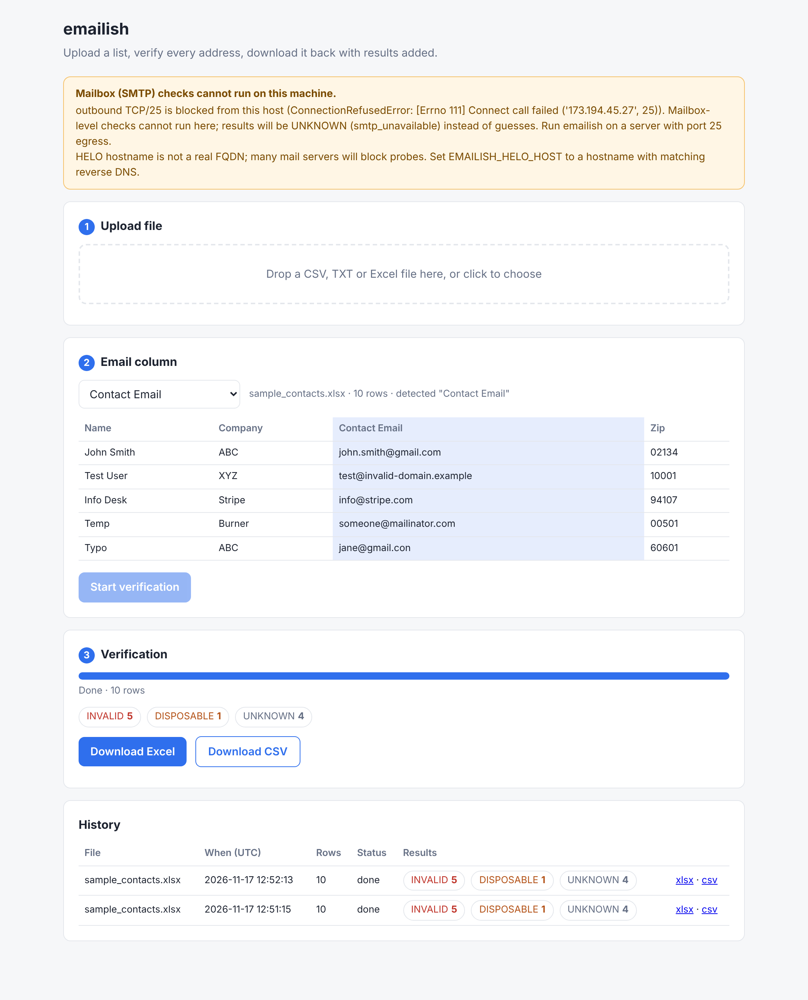

# emailish

**Upload an email list → verify every address → download a new Excel/CSV with results.**

An independent, self-hosted email verifier that follows the same methodology as
professional verification platforms (DNS/MX → disposable intelligence → SMTP mailbox
diagnostics → catch-all detection → risk classification). The research behind it is
in [`research/`](research/).



## Quick start

```bash
./run.sh
```

Open http://127.0.0.1:8000. The first run creates `.venv` and installs the dependencies.

**Windows (PowerShell or cmd):** `run.sh` does not work on Windows; use `run.bat`:

```powershell
.\run.bat              # SMTP mailbox checks on
.\run.bat --no-smtp    # SMTP mailbox checks off
```

Requires Python 3.10+ from python.org ("Add python.exe to PATH" ticked). In PowerShell,
environment variables are set with `$env:NAME = "value"` on a separate line (for example
`$env:EMAILISH_HELO_HOST = "verify.yourdomain.com"`), not with the `NAME=value command`
form used on Linux and macOS.

Or with Docker:

```bash
docker compose up --build
```

Workflow: upload a **CSV, TXT or XLSX** file → the email column is detected (you can
change it) → **Start verification** → progress bar → **Download Excel / CSV**. Past jobs
are listed under **History** (SQLite, in `data/`).

Command line, using the same engine:

```bash
python -m app.cli check someone@example.org
python -m app.cli file contacts.xlsx            # writes contacts_verified.csv / .xlsx
python -m app.cli health                        # DNS backend + SMTP egress status
```

## ⚠️ Mailbox (SMTP) checks need the right network

Confirming whether a mailbox exists means talking SMTP to the recipient's mail server on
**TCP port 25**. Many networks block that port: most home ISPs, AWS, GCP and Azure by
default, and the cloud sandbox this was built in. emailish tests this at startup and
before every job.

- **If port 25 is blocked**, every address that needs an SMTP check is reported as
  `UNKNOWN / smtp_unavailable` with that reason. The tool **never guesses VALID**.
  Syntax, DNS, Null MX, disposable, free, role and typo results are still real.
- **For meaningful mailbox results**, run emailish on a server that:
  1. allows outbound TCP/25;
  2. has a static IP whose **reverse DNS (PTR)** matches `EMAILISH_HELO_HOST`;
  3. is not on a blocklist (check at https://check.spamhaus.org).

  Then set:

  ```bash
  export EMAILISH_HELO_HOST=verify.yourdomain.com
  export EMAILISH_MAIL_FROM=bounce@yourdomain.com
  ./run.sh
  ```

  Probes from hosts without these are blocked more often, which raises the share of
  UNKNOWN results. That is reported honestly, not hidden.

No email is ever sent: the session stops after `RCPT TO` (`RSET`/`QUIT`, never `DATA`).

## Output columns

Your original columns are kept unchanged, in their original order. Every cell is read as
text, so ZIP codes and IDs keep their leading zeros. These columns are appended:

| column | meaning |
|---|---|
| `email_status` | VALID · INVALID · CATCH_ALL · DISPOSABLE · ROLE_BASED · RISKY · UNKNOWN · TIMEOUT |
| `syntax_valid` | RFC 5321/5322 syntax OK |
| `domain_valid` | domain exists and has a usable mail route (Unknown on DNS failure) |
| `mx_found` | domain publishes MX records (No can still be deliverable via the A record, RFC 5321 §5.1) |
| `disposable` | disposable provider (domain list **or** disposable MX infrastructure) |
| `free_email` | free mailbox provider (Gmail, Outlook, …) |
| `role_based` | role/group local part (info@, sales@, …) |
| `smtp_status` | accepted · rejected · catch_all · greylisted · blocked · temp_error · mailbox_full · timeout · connection_failed · protocol_error · not_checked · unavailable |
| `catch_all` | Yes / No / Unknown (domain accepts any address) |
| `verification_reason` | human-readable evidence, including the raw SMTP reply |
| `confidence` | 0–100 strength of the evidence behind `email_status`. **0 = no verdict reached** |
| `verified_at` | UTC timestamp |
| `sub_status` | machine reason code (e.g. `mailbox_not_found`, `antispam_system`, `does_not_accept_mail`) |
| `certainty` | **CONFIRMED** (decided by direct evidence) or **UNCERTAIN** |
| `did_you_mean` | typo suggestion (e.g. `jane@gmail.con` → `jane@gmail.com`) |
| `mx_host`, `mail_provider`, `smtp_code` | which server answered, its platform, and its code (e.g. `550 5.1.1`) |

If your file already has a column with one of these names, ours is written as `verify_<name>`.

### When each status is given

| status | rule |
|---|---|
| VALID | SMTP `250` for the address **and** a random address on the same domain was rejected. MX records alone never produce VALID. |
| INVALID | bad syntax, empty cell, non-existent domain, Null MX, no mail host, unroutable MX, or a **recipient-specific** SMTP rejection (`5.1.1`, "user unknown", Microsoft 365 `5.4.1`, `5.2.1` disabled) |
| CATCH_ALL | the server accepted a random address too, so this mailbox cannot be confirmed |
| DISPOSABLE | the domain is on the disposable list, or its MX belongs to disposable-mail infrastructure |
| ROLE_BASED | a role address whose mailbox was confirmed (or that sits on a catch-all domain). A role address that is rejected stays INVALID. |
| RISKY | accepted, but the catch-all status could not be determined; mailbox full; likely typo domain; spam-trap keyword |
| UNKNOWN | blocked/anti-spam, greylisted (after a retry pass), temporary errors, ambiguous replies, DNS failure, SMTP unavailable |
| TIMEOUT | the mail server did not answer in time |

A policy or blocklist rejection (`5.7.x`, Spamhaus, …) is **UNKNOWN, not INVALID**.
It tells you about the verifier's IP, not about the mailbox.

## Configuration (environment variables)

| variable | default | |
|---|---|---|
| `EMAILISH_HELO_HOST` | machine FQDN | HELO/EHLO name. Should have matching reverse DNS. |
| `EMAILISH_MAIL_FROM` | `verify@<helo>` | envelope sender used for probes |
| `EMAILISH_SMTP_ENABLED` | `true` | `false` = DNS/list checks only |
| `EMAILISH_SMTP_GLOBAL_CONCURRENCY` | 8 | concurrent SMTP sessions overall |
| `EMAILISH_SMTP_PER_HOST` | 1 | concurrent sessions per MX host |
| `EMAILISH_SMTP_MX_MIN_INTERVAL` | 2.0 | seconds between connections to one MX host |
| `EMAILISH_SMTP_RCPT_PER_SESSION` | 10 | addresses of one domain tested per SMTP session |
| `EMAILISH_SMTP_CONNECT_TIMEOUT` / `_COMMAND_TIMEOUT` | 10 / 15 | seconds |
| `EMAILISH_GREYLIST_RETRY_DELAY` | 90 | seconds before re-trying greylisted addresses once (0 = off) |
| `EMAILISH_DNS_MODE` | `auto` | `auto` uses the system resolver if it passes an MX self-test, otherwise DNS-over-HTTPS; or `system` / `doh` |
| `EMAILISH_DATA_DIR` | `./data` | uploads, results, SQLite |

## Tests

```bash
pip install -r requirements-dev.txt
pytest                                   # offline: mock SMTP servers + fake DNS
EMAILISH_LIVE=1 pytest tests/test_live.py -s   # live DNS checks
```

The offline suite runs every scenario against real SMTP conversations with local mock
servers: valid mailbox, unknown user, catch-all, greylisting (resolved and persistent),
Spamhaus blocks, Microsoft 365 `5.4.1`, mailbox full or disabled, ambiguous `5xx`,
garbage banner, banner and RCPT timeouts, connection refused, mid-session disconnect,
rejected `MAIL FROM`, implicit MX, Null MX, NXDOMAIN, dangling MX, DNS failure,
unroutable MX, disposable by list and by MX, and typo domains. It also checks that
`DATA` is never sent, that duplicates are probed once, and the rate-limit spacing.
Results from the last run are in [`research/test-results.md`](research/test-results.md).

### QA with a 1,000-record synthetic list (SMTP disabled)

```bash
python test_data/run_qa.py        # starts the app, uploads CSV + XLSX, checks every row and both exports
python test_data/run_layers.py    # syntax, dataset and DNS layers tested separately
```

Report: [`research/QA_REPORT.md`](research/QA_REPORT.md) · data:
[`research/TEST_DATA_GUIDE.md`](research/TEST_DATA_GUIDE.md) · bugs:
[`research/FAILED_TESTS.md`](research/FAILED_TESTS.md)

## Benchmark against ZeroBounce / MillionVerifier / Hunter

```bash
python -m benchmark.run_benchmark --selftest          # adapters vs. vendors' public test keys (free)
cp benchmark/controlled_addresses.example.csv benchmark/controlled_addresses.csv   # fill in addresses you control
export ZEROBOUNCE_API_KEY=... MILLIONVERIFIER_API_KEY=... HUNTER_API_KEY=...
python -m benchmark.run_benchmark benchmark/controlled_addresses.csv          # dry run: shows credit cost
python -m benchmark.run_benchmark benchmark/controlled_addresses.csv --yes    # real run
```

The run writes `benchmark/results/<time>/report.md`: accuracy against your ground
truth, a confusion matrix per vendor, and every disagreement with emailish's reason.
**No parity claim is made until this has been run** on a host with port 25 egress.

## Data sources
- Disposable domains: [disposable-email-domains](https://github.com/disposable-email-domains/disposable-email-domains) (CC0)
- Free providers: [Kikobeats/free-email-domains](https://github.com/Kikobeats/free-email-domains) (MIT)
- Disposable MX operators: derived by `scripts/derive_disposable_mx.py`, with manual exclusion of shared infrastructure (method in the data file header)
